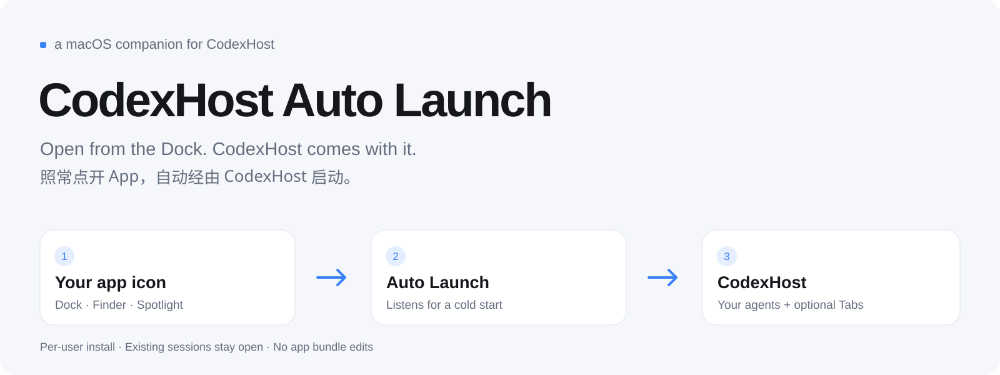
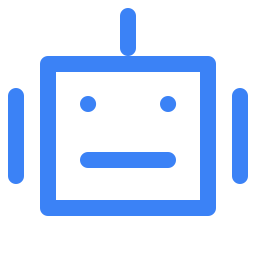
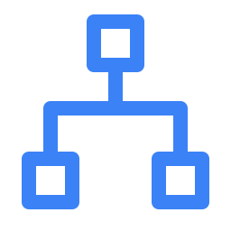

<picture>
  <source media="(prefers-color-scheme: dark)" srcset="assets/banner-dark.svg">
  
</picture>

<p>
  
  
  <a href="https://github.com/BytePioneer-AI/codex-host"></a>
  <a href="https://github.com/yuanruoyu515/codexhost-auto-launch/actions/workflows/ci.yml"></a>
  <a href="LICENSE"></a>
  <a href="https://www.threads.com/@realtimyry"></a>
</p>

**English** · [简体中文](README.zh-CN.md) · [Setup guide for AI agents](AGENTS.md)

I wanted to keep opening the usual app icon and still get CodexHost. This small macOS helper listens for a fresh Codex Desktop launch from the Dock, Finder or Spotlight, then hands it to [CodexHost](https://github.com/BytePioneer-AI/codex-host) automatically.

It is an independent community companion. CodexHost still does the launching and injection; this helper calls its existing `launch` command. The original implementation is in my unmerged [codex-host#702](https://github.com/BytePioneer-AI/codex-host/pull/702). This repository packages it separately, with installation checks, migration from the earlier helpers, and recovery when its own old supervisor gets stuck.

> [!IMPORTANT]
> **A cold start restarts once.** The app may appear, close, and reopen briefly as CodexHost takes over. Installing the helper leaves an already-open session alone. Initial file-open and deep-link requests are not forwarded to the replacement process.

##  What you get

<table>
  <tr>
    <td width="50%" valign="top"><b>Keep your usual app icon</b><br>Open Desktop from the Dock, Finder or Spotlight. The helper calls CodexHost for you.</td>
    <td width="50%" valign="top"><b>Quiet startup</b><br>Passes <code>CODEXHOST_CONSOLE=0</code> so the handoff does not automatically open the console in a browser.</td>
  </tr>
  <tr>
    <td valign="top"><b>Existing chats stay open</b><br>Installing, updating or removing the listener leaves active Desktop sessions running.</td>
    <td valign="top"><b>Recovers its own stuck launcher</b><br>After a cold start, waits for the previous supervisor to finish. If it is stuck and no other Desktop is alive, releases its stale ownership before handing off.</td>
  </tr>
</table>

It starts listening at login, without opening Desktop. While idle it uses macOS application notifications rather than repeatedly scanning every app. It does not edit either application bundle or require Accessibility or Apple Events control permission.

##  Better with CodexHost + Tabs

If you use CodexHost with my [ChatGPT Codex Tabs](https://github.com/yuanruoyu515/chatgpt-codex-tabs), add this helper so the same setup comes back when you open the app normally.

| Component | Its job |
|---|---|
| [CodexHost](https://github.com/BytePioneer-AI/codex-host) | Runs the other agent harnesses inside Desktop and opens its local debug port |
| **Auto Launch** | Hands normal app cold starts to CodexHost |
| [ChatGPT Codex Tabs](https://github.com/yuanruoyu515/chatgpt-codex-tabs) | Adds browser-style thread tabs, with CodexHost agent logos when available |

Install this helper below. Then install Tabs in its **CodexHost mode** (`python3 install.py` in that repository, without `--standalone`). Each project remains separately installed and separately removable. Tabs can also run on its own; this combination is for keeping CodexHost and the tab bar together.

## Before you start

| You need | Notes |
|---|---|
| macOS 13+ | Requires a logged-in desktop session. Builds for Apple Silicon or Intel on that Mac |
| Electron Codex / ChatGPT Desktop | Bundle ID `com.openai.codex`, with `Contents/Resources/app.asar`. The separate native ChatGPT app is not a target |
| [CodexHost](https://github.com/BytePioneer-AI/codex-host) | Install and verify it first. The default launcher is `/Applications/codexhost.app/Contents/MacOS/codexhost` |
| Xcode Command Line Tools with Swift 6 | Run `xcrun swiftc --version`. If the tools are missing, run `xcode-select --install` |
| Python 3.9+ | Used to install and diagnose. Standard library only; no pip packages |

Tested locally on macOS 27.0.1 arm64 with Swift 6.4, CodexHost 0.17.4 and Desktop 26.1103.41825. The deployment target is macOS 13; that is not a claim of a full test matrix across older macOS releases or Intel machines.

##  Install

```bash
git clone https://github.com/yuanruoyu515/codexhost-auto-launch.git
cd codexhost-auto-launch
python3 install.py
```

Run as your normal user, without `sudo`. Installation compiles the listener on this Mac, signs that helper ad hoc, and registers a per-user LaunchAgent. Neither official app is patched or re-signed.

```bash
python3 doctor.py
```

`doctor.py` checks that the listener is ready for the next cold start. Desktop can stay closed. When you want to check actual injection too, open Desktop normally and run:

```bash
python3 doctor.py --live
```

If Desktop was already open when you installed, finish your work, quit it completely, then open it again. The helper deliberately leaves that existing session alone.

<details>
<summary><b>Custom CodexHost location</b></summary>

```bash
python3 install.py --launcher /absolute/path/to/native/codexhost
```

Use the native Mach-O launcher, not an npm JavaScript entry point or a shell wrapper. Keep that executable installed at the same location. The `.app` distribution is the simplest option. The installer checks the file type before changing services.

</details>

<details>
<summary><b>Already installed the PR helper or the earlier local listener?</b></summary>

The installer recognizes these two predecessors:

- `ai.bytepioneer.codexhost.auto-launch` from PR #702;
- `com.ruoyu.codexhost.autoinject` from the earlier local version.

It checks their expected program paths and process-group settings, backs up their plists, unloads those listeners, and installs this one. Existing supervisors and Desktop sessions stay alive; old source and logs are retained. An unrecognized configuration stops migration for manual review rather than replacing it.

Do not leave several cold-start helpers enabled at once. For Tabs, use its CodexHost mode instead of its standalone launcher.

</details>

## Update

Inside a clean checkout:

```bash
git pull --ff-only
python3 install.py
python3 doctor.py
```

If you edited the checkout, keep those edits before updating. Reinstallation recompiles the helper and restarts only its listener. It does not update CodexHost itself.

##  Troubleshooting

Run `python3 doctor.py` first. Add `--live` when investigating a running app.

| Result | What to do |
|---|---|
| Listener not installed or not running | Run `python3 install.py` again; check `service.log` if it fails |
| CodexHost executable missing | Reinstall CodexHost, or reinstall this helper with its new native launcher path |
| Listener ready, no current injection | An existing session may predate installation. At a convenient break, quit Desktop completely and open it normally |
| Duplicate legacy listener | Run the installer to migrate the recognized old configuration |
| `Previous supervisor is still cleaning up` / lock timeout | Check `events.jsonl`. Recovery only applies to a supervisor this listener owns. A manually started external launcher is left alone |
| A handoff failed | Inspect `launcher.log`. Further handoffs pause for 30 seconds; there is no automatic retry loop |
| Another Desktop instance is running | Close the extra instance when convenient. The helper avoids taking over a new launch while another instance is alive |

Installed files live at `~/Library/Application Support/codexhost-auto-launch/`. The service label is `com.ruoyu.codexhost.auto-launch`; its plist is under `~/Library/LaunchAgents/`.

`events.jsonl` records handoffs and skips and rotates after 1 MiB. `launcher.log` and `service.log` retain launcher output and listener errors; stop the listener before clearing them. Review and redact local paths or sensitive launcher output before sharing logs. Diagnostics do not upload anything.

##  Let your agent set it up

Paste this into an agent that can run commands on your Mac:

```text
Set up https://github.com/yuanruoyu515/codexhost-auto-launch on this Mac.
Follow AGENTS.md. Keep my current Desktop session open and report doctor.py results.
```

##  How it works

1. A Swift listener subscribes to `NSWorkspace` launch and termination notifications.
2. It recognizes a new unified Electron Desktop instance, deduplicates notifications and skips an instance already launched with a debug port.
3. It calls the installed native `codexhost launch` with `CODEXHOST_CONSOLE=0` and the detected app's `CODEXHOST_INSTALL_ROOT`.
4. CodexHost owns the restart, runtime and injection. Optional plugins such as Tabs attach through the debug port as usual.

On a quick quit/reopen, the listener allows three seconds for its old supervisor to finish. If that supervisor is stuck, it checks that no other Desktop instance is alive before terminating its own old supervisor and its identified direct Desktop Controller children. A live controlled window prevents recovery. External supervisors are not terminated. Notifications older than eight seconds are skipped.

##  Uninstall

```bash
python3 uninstall.py
```

If you deleted the checkout:

```bash
python3 "$HOME/Library/Application Support/codexhost-auto-launch/uninstall.py"
```

The listener is removed. An active CodexHost session continues running. Source, backups and logs stay in Application Support; remove that folder after uninstalling if you no longer need them. CodexHost and Tabs are separate installations.

##  Limits

- macOS desktop sessions only. No Windows, Linux, remote Host or browser support.
- One restart per cold start. Initial file-open and deep-link requests are not forwarded.
- A CodexHost failure after it closes the original app can leave Desktop closed.
- It follows the app's current bundle identity and CodexHost CLI. Future changes may need a helper update.
- The helper does not add a debug listener itself. CodexHost's local debug port permits code execution inside Desktop by other programs on the Mac; keep it bound to loopback.

## Development

```bash
python3 -m unittest discover -s tests -p 'test_manage.py' -v
python3 tests/test_lifecycle.py
```

The lifecycle test compiles a separate fixture app and listener, then exercises real macOS launch notifications. It covers startup preservation, cold starts, quick reopen, duplicate and warm launches, stuck-supervisor/controller recovery, other-window protection, missing launchers and failure cooldown. It uses unique temporary app identities and never targets the real Desktop or installs the production LaunchAgent.

See [CONTRIBUTING.md](CONTRIBUTING.md) for changes and [CHANGELOG.md](CHANGELOG.md) for releases.

## Credits

Written by Ruoyu. The original source-only helper was proposed in [codex-host#702](https://github.com/BytePioneer-AI/codex-host/pull/702). This standalone repository adds packaging and the local stale-supervisor fix. It is independently maintained and is not an official CodexHost release.

README layout follows my [ChatGPT Codex Tabs](https://github.com/yuanruoyu515/chatgpt-codex-tabs). Banner and section icons are included as SVG source.

Find me on Threads: [@realtimyry](https://www.threads.com/@realtimyry). [MIT License](LICENSE).
