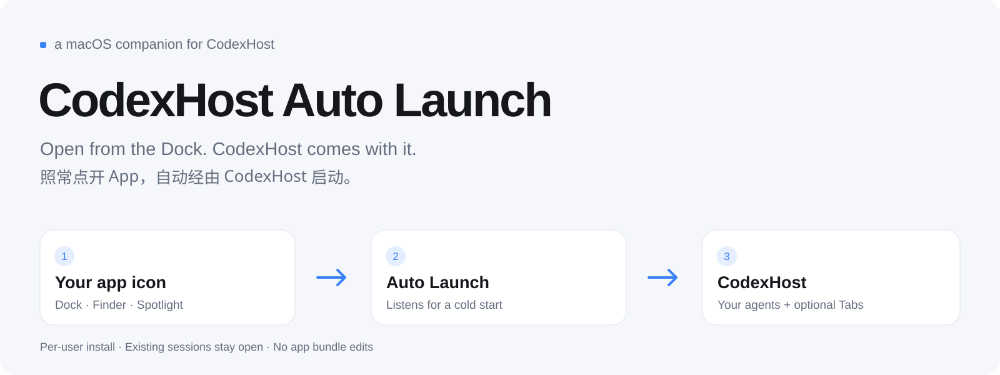
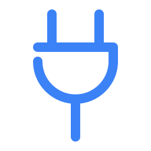
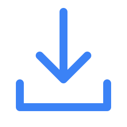
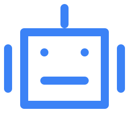
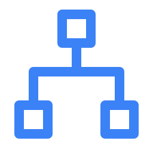

<picture>
  <source media="(prefers-color-scheme: dark)" srcset="assets/banner-dark.svg">
  
</picture>

<p>
  
  
  <a href="https://github.com/BytePioneer-AI/codex-host"></a>
  <a href="https://github.com/yuanruoyu515/codexhost-auto-launch/actions/workflows/ci.yml"></a>
  <a href="LICENSE"></a>
  <a href="https://www.threads.com/@realtimyry"></a>
</p>

[English](README.md) · **简体中文** · [给 AI agent 的安装指南](AGENTS.md)

我想继续点原来的 App 图标，又想保留 CodexHost 的功能。这个 macOS 小工具会监听从 Dock、Finder 或 Spotlight 打开的新 Codex Desktop 实例，自动交给 [CodexHost](https://github.com/BytePioneer-AI/codex-host) 启动。

这是独立维护的社区配套工具。实际启动和注入仍由 CodexHost 完成，监听器只调用它已有的 `launch` 命令。原始实现放在我尚未合并的 [codex-host#702](https://github.com/BytePioneer-AI/codex-host/pull/702) 中；这里单独打包，补上安装检查、旧版迁移，以及旧启动器卡住时的恢复逻辑。

> [!IMPORTANT]
> **每次冷启动会重开一次。** 窗口可能先出现、关闭，再重新打开，这是 CodexHost 接管的过程。安装时已经打开的会话会保留。首次启动附带的文件打开请求和深链不会转发到重开的进程。

##  能做什么

<table>
  <tr>
    <td width="50%" valign="top"><b>继续点原来的图标</b><br>从 Dock、Finder 或 Spotlight 打开 Desktop，自动调用 CodexHost。</td>
    <td width="50%" valign="top"><b>静默接管</b><br>传入 <code>CODEXHOST_CONSOLE=0</code>，接管时不自动打开控制台网页。</td>
  </tr>
  <tr>
    <td valign="top"><b>保留正在用的会话</b><br>安装、更新、卸载监听器，都不会关闭当前 Desktop 会话。</td>
    <td valign="top"><b>回收自己卡住的启动器</b><br>冷启动时先等旧启动器收尾；确认没有其他 Desktop 实例后，清理它自己遗留的启动器和控制器，再接管。</td>
  </tr>
</table>

登录后会开始监听，但不会自动打开 Desktop。空闲时订阅 macOS 的应用启动通知，不反复扫描全部 App。无需修改应用包，也不需要辅助功能或 Apple Events 控制权限。

##  推荐搭配 CodexHost + Tabs

如果你正在用 CodexHost 和我的 [ChatGPT Codex Tabs](https://github.com/yuanruoyu515/chatgpt-codex-tabs)，加上这个工具后，照常点开 App 就能恢复这套使用方式。

| 组件 | 各自负责什么 |
|---|---|
| [CodexHost](https://github.com/BytePioneer-AI/codex-host) | 在 Desktop 中运行其他 agent harness，并打开本机调试端口 |
| **Auto Launch** | 把从普通图标发起的冷启动交给 CodexHost |
| [ChatGPT Codex Tabs](https://github.com/yuanruoyu515/chatgpt-codex-tabs) | 添加浏览器式对话标签；有 CodexHost 图标时，在标签上显示对应 agent 的 logo |

先按下面的步骤安装 Auto Launch，再按 Tabs 仓库的 **CodexHost 模式**安装：在 Tabs 仓库运行 `python3 install.py`，不加 `--standalone`。三个项目分别安装、分别卸载。Tabs 本身也能独立使用；这套组合适合同时保留 CodexHost 和标签栏。

## 安装前

| 需要什么 | 说明 |
|---|---|
| macOS 13+ | 需要已登录的桌面会话。在当前 Mac 上为 Apple Silicon 或 Intel 编译 |
| Electron 版 Codex / ChatGPT Desktop | bundle ID 为 `com.openai.codex`，包含 `Contents/Resources/app.asar`。独立原生 ChatGPT 不在范围内 |
| [CodexHost](https://github.com/BytePioneer-AI/codex-host) | 先安装并确认可用。默认启动器为 `/Applications/codexhost.app/Contents/MacOS/codexhost` |
| 带 Swift 6 的 Xcode Command Line Tools | 运行 `xcrun swiftc --version` 检查；缺失时运行 `xcode-select --install` |
| Python 3.9+ | 用于安装和诊断，只用标准库，无需 pip 装包 |

本机验证组合：macOS 27.0.1 arm64、Swift 6.4、CodexHost 0.17.4、Desktop 26.1103.41825。编译目标是 macOS 13，不代表已在所有旧版系统或 Intel 机器上完整测试。

##  安装

```bash
git clone https://github.com/yuanruoyu515/codexhost-auto-launch.git
cd codexhost-auto-launch
python3 install.py
```

用当前登录的普通用户运行，不加 `sudo`。安装器会在本机编译监听器，为它做 ad hoc 签名，并注册当前用户的 LaunchAgent。官方 App 和 CodexHost 的应用包都不改动。

```bash
python3 doctor.py
```

默认检查监听器是否准备好接管下一次冷启动，Desktop 可以保持关闭。需要检查实际注入时，照常打开 Desktop，再运行：

```bash
python3 doctor.py --live
```

如果安装时 Desktop 已打开，先完成手头工作，完全退出后再点开。监听器会保留安装前已经打开的实例。

<details>
<summary><b>CodexHost 装在别处？</b></summary>

```bash
python3 install.py --launcher /absolute/path/to/native/codexhost
```

选择原生 Mach-O 启动器，不要选 npm 的 JavaScript 入口或 shell 包装脚本。这个可执行文件需要一直保留在指定位置；使用 `.app` 发行版最省事。安装器会在改动服务前检查文件类型。

</details>

<details>
<summary><b>已装过 PR 里的助手或早期本地版？</b></summary>

安装器识别两种旧服务：

- PR #702 的 `ai.bytepioneer.codexhost.auto-launch`；
- 早期本地版的 `com.ruoyu.codexhost.autoinject`。

确认程序路径及进程组设置符合预期后，会备份旧 plist、卸载旧监听器，再安装这一版。正在运行的启动器和 Desktop 会话会保留，旧源码和日志也保留。配置不符合预期时会停止迁移，提示手动检查。

不要同时启用多套冷启动接管工具。搭配 Tabs 时，使用它的 CodexHost 模式。

</details>

## 更新

工作区没有自己的改动时：

```bash
git pull --ff-only
python3 install.py
python3 doctor.py
```

如果改过源码，先保留自己的改动。重新安装会编译并重启监听器，不会关闭当前会话，也不会更新 CodexHost 本体。

##  排查问题

先运行 `python3 doctor.py`。检查正在运行的 App 时加 `--live`。

| 结果 | 怎么处理 |
|---|---|
| 监听器未安装或未运行 | 再运行 `python3 install.py`；失败时查看 `service.log` |
| 找不到 CodexHost 启动器 | 重装 CodexHost，或用它的新原生启动器路径重装本工具 |
| 监听器正常，但当前未注入 | 可能是安装前就打开的会话。有空时完全退出 Desktop，再照常打开 |
| 发现重复的旧监听器 | 运行安装器，迁移已识别的旧配置 |
| `Previous supervisor is still cleaning up` 或锁等待超时 | 查看 `events.jsonl`。自动回收只处理这个监听器自己启动的旧进程，不结束手动启动的外部启动器 |
| 接管失败 | 查看 `launcher.log`。之后 30 秒暂停新接管，不会循环自动重试 |
| 另有 Desktop 实例 | 方便时关闭多余实例；另一实例仍在运行时，监听器会跳过新接管 |

安装目录：`~/Library/Application Support/codexhost-auto-launch/`。服务名：`com.ruoyu.codexhost.auto-launch`；plist 在 `~/Library/LaunchAgents/`。

`events.jsonl` 记录接管和跳过原因，超过 1 MiB 会轮换；`launcher.log` 和 `service.log` 保留启动器输出及监听器错误。清日志前先停止监听器。分享前检查并遮掉本地路径或敏感输出，诊断工具不会上传日志。

##  让 agent 安装

把下面这段发给能在你的 Mac 上执行命令的 agent：

```text
在这台 Mac 安装 https://github.com/yuanruoyu515/codexhost-auto-launch。
遵循仓库 AGENTS.md，保留我当前的 Desktop 会话，汇报 doctor.py 的检查结果。
```

##  工作方式

1. Swift 监听器订阅 `NSWorkspace` 应用启动和退出通知。
2. 识别新的统一版 Electron Desktop，去重通知，并跳过已经带调试端口启动的受控实例。
3. 调用已安装的原生 `codexhost launch`，传入 `CODEXHOST_CONSOLE=0` 和检测到的 App 的 `CODEXHOST_INSTALL_ROOT`。
4. CodexHost 负责重启、运行时及注入。Tabs 等可选插件仍按自己的方式连接调试端口。

快速退出再打开时，会先给旧启动器 3 秒收尾。若它卡住，确认没有其他 Desktop 实例后，才结束自己持有的旧启动器及已识别的直接子进程 Desktop Controller。有受控窗口时不回收，也不结束外部启动器。到达时已超过 8 秒的启动通知会跳过。

##  卸载

```bash
python3 uninstall.py
```

已经删掉克隆的仓库时：

```bash
python3 "$HOME/Library/Application Support/codexhost-auto-launch/uninstall.py"
```

卸载监听器后，当前 CodexHost 会话继续运行。源码、备份和日志保留在 Application Support；不再需要时，可在卸载后删除该目录。CodexHost 和 Tabs 仍各自独立安装。

##  限制

- 只支持 macOS 桌面会话，不支持 Windows、Linux、远程 Host 或浏览器。
- 每次冷启动会多一次重开；首次文件打开请求和深链不转发。
- CodexHost 若在关闭原始 App 后启动失败，Desktop 可能保持关闭。
- 依赖当前应用标识和 CodexHost CLI，未来变化可能需要更新助手。
- 监听器本身不开调试端口。CodexHost 的本机调试端口允许同一 Mac 上的其他程序在 Desktop 内执行代码，应保持只绑定 loopback。

## 开发

```bash
python3 -m unittest discover -s tests -p 'test_manage.py' -v
python3 tests/test_lifecycle.py
```

生命周期测试会编译独立测试 App 和监听器，使用真实 macOS 启动通知，覆盖已有会话保护、连续冷启动、快速重开、重复启动、卡住的启动器及控制器回收、其他窗口保护、启动器缺失和失败冷却。测试使用唯一的临时应用标识，不操作真实 Desktop，也不安装正式 LaunchAgent。

改动流程见 [CONTRIBUTING.md](CONTRIBUTING.md)，版本记录见 [CHANGELOG.md](CHANGELOG.md)。

## 致谢

作者 Ruoyu。原始源码助手已提交到 [codex-host#702](https://github.com/BytePioneer-AI/codex-host/pull/702)。这个独立仓库补上打包和旧启动器卡死恢复，由我维护，不是 CodexHost 官方发行版。

README 版式参考我的 [ChatGPT Codex Tabs](https://github.com/yuanruoyu515/chatgpt-codex-tabs)，横幅和章节图标均附 SVG 源文件。

Threads：[@realtimyry](https://www.threads.com/@realtimyry)。[MIT 许可证](LICENSE)。
